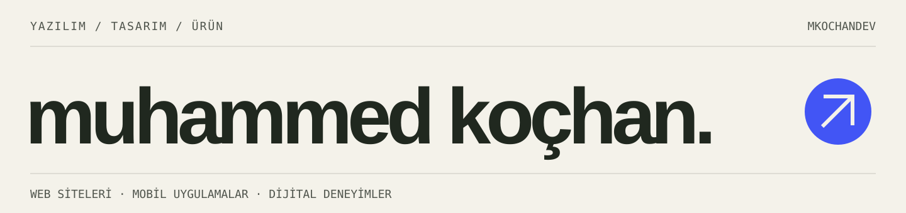

 

Web siteleri ve mobil uygulamalar geliştiriyorum. Arayüzü, görsel kimliği ve arkasındaki sistemi birlikte düşünüyorum. Burada kendi ürünlerim ve tasarım çalışmalarım var.

[**Portföy ↗**](https://mkochandev.github.io/) &nbsp; / &nbsp; [**Bir proje konuşalım ↗**](mailto:muhammedkochandev@gmail.com)

 

## 01 / Erişte

**Bütün aboneliklerin tek kâsede.**

Dijital abonelikleri ve düzenli giderleri bir arada tutan mobil uygulama. Aşağıdaki görsel, projenin kendi marka çalışmasından.

### [Siteyi aç ↗](https://eriste.app/) &nbsp; · &nbsp; [Kaynak kodu ↗](https://github.com/Mkochandev/eriste-web)

Kaynak bağlantısı, tanıtım sitesinin herkese açık reposuna gider.

 

## 02 / GaziUstam

**İşletmeler için yazılım ve dijital tasarım.**

Web, mobil uygulama ve yapay zekâ otomasyonu üzerine ajans ve danışmanlık projem. Aşağıda sitenin gerçek ekran görüntüsü bulunuyor.

### [Siteyi aç ↗](https://gaziustam.com/) &nbsp; · &nbsp; [Kaynak kodu ↗](https://github.com/Mkochandev/Gaziustam-Yazilim)

 

## 03 / Scribble

**Her sektöre başka bir karakter.**

Farklı sektörler için tasarlayıp kodladığım, tarayıcıda gezilebilen konsept siteler serisi. Her çalışma ayrı, herkese açık bir repoda; Türkçe ve İngilizce hazırlanacak.

| İlk çalışma | Alan | Durum |
| :--- | :--- | :--- |
| **Scribble — Streetwear** | Sokak giyimi / butik giyim markası | Hazırlık aşamasında |

Seri: `Scribble` · Repo düzeni: `scribble-[alan]` · İlk repo adı: `scribble-streetwear` 
Scribble çalışmaları portföy amaçlı tasarım demolarıdır.

 

<strong>Kullandığım araçlar</strong>

 

**Arayüz:** HTML, CSS, JavaScript, TypeScript, Tailwind CSS, Astro  
**Uygulama ve sunucu:** PHP, Laravel, Node.js, Express, React Native, Expo  
**Veri:** MySQL, PostgreSQL, Supabase

 

---

**Birlikte bir şey üretelim.**  
[muhammedkochandev@gmail.com](mailto:muhammedkochandev@gmail.com) &nbsp; / &nbsp; [gaziustam.com](https://gaziustam.com/)
