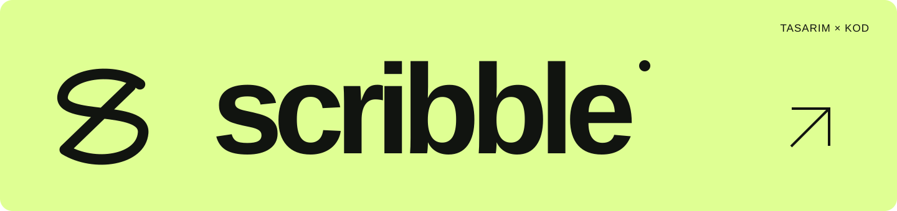
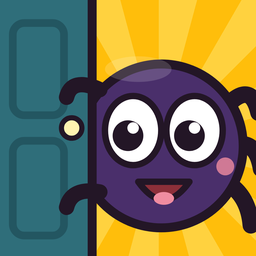

<a href="https://mkochandev.github.io/">Scribble’ı keşfet ↗</a> &nbsp; 

### Scribble nedir?

**Tek marka. Farklı dünyalar.**

Scribble, aynı markayı farklı sektörlerde yeniden hayal ettiğim tasarım ve geliştirme projesi. Her repoda Scribble, o sektörün gerçek bir markasıymış gibi ele alınıyor. Logo aynı kalıyor; görsel dil, içerik ve deneyim o dünyaya göre değişiyor.

Bugün bir streetwear markası, sıradaki projede bambaşka bir iş. Her yeni repo, Scribble’ın başka bir ihtimalini keşfediyor.

### Diğer projelerim

<table>
<tr>
<td width="33%" valign="top">
 <strong>Erişte</strong> Aboneliklerin ve düzenli giderlerin tek yerde.  <a href="https://eriste.app/">Siteyi gör ↗</a>
</td>
<td width="33%" valign="top">
 <strong>GaziUstam</strong> Web, mobil uygulama ve yazılım danışmanlığı.  <a href="https://gaziustam.com/">Siteyi gör ↗</a>
</td>
<td width="33%" valign="top">
 <strong>Cobweb — Kapıyı Açma</strong> Itsy ağını örüyor. Kapı kapalı kaldıkça dünyası büyüyor. iPhone için, yakında.  <a href="https://cobweb.kochanmuhammed5.workers.dev/">Siteyi gör ↗</a>
</td>
</tr>
</table>

 
 

**Erken form tutan, erken dağılır.**
---

<strong>muham²ed</strong> &nbsp; / &nbsp; tasarım × kod &nbsp; / &nbsp; <a href="https://github.com/Mkochandev">GitHub ↗</a>
