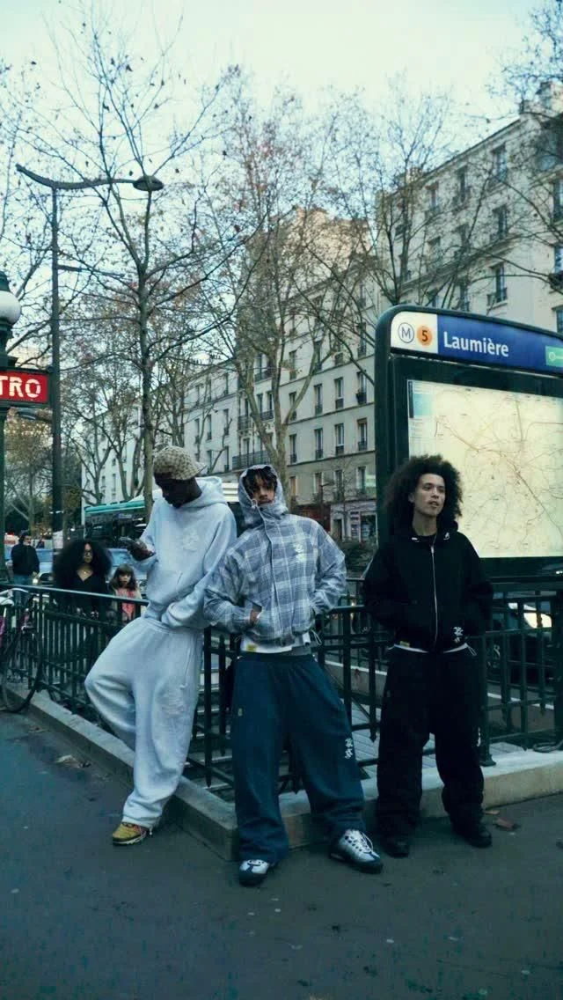

<a href="https://github.com/search?q=user%3AMkochandev+scribble&amp;type=repositories">GitHub’da Scribble ara ↗</a> &nbsp; / &nbsp; <a href="https://mkochandev.github.io/">Portföy ↗</a>

### Scribble nedir?

**Tek marka. Farklı dünyalar.**

Scribble, aynı markayı farklı sektörlerde yeniden hayal ettiğim tasarım ve geliştirme projesi. Her repoda Scribble, o sektörün gerçek bir markasıymış gibi ele alınıyor. Logo aynı kalıyor; görsel dil, içerik ve deneyim o dünyaya göre değişiyor.

Bugün bir streetwear markası, sıradaki projede bambaşka bir iş. Her yeni repo, Scribble’ın başka bir ihtimalini keşfediyor.

### 001 / Scribble dünyaları

<table>
<tr>
<td width="38%" valign="top">

</td>
<td width="62%" valign="middle">
001 / SOKAK GİYİMİ &nbsp; · &nbsp; YAYINDA
<h2>Scribble Streetwear.</h2>

<strong>Aynı markanın ilk dünyası. Sokağın ritmiyle şekillenen bir mağaza.</strong>

Scribble bu kez bir streetwear markası. Siyah-beyaz bir görsel dil, büyük tipografi ve hareketli görüntülerle başlayan deneyim; koleksiyondan ürün detayına kadar aynı tavrı sürdürüyor.

TR / EN &nbsp; · &nbsp; KOLEKSİYON &nbsp; · &nbsp; ÜRÜN DETAYLARI &nbsp; · &nbsp; DEMO SEPETİ

 

<a href="https://mkochandev.github.io/scribble-streetwear/"><strong>Deneyimi keşfet ↗</strong></a> &nbsp; / &nbsp; <a href="https://github.com/Mkochandev/scribble-streetwear">Kaynak kodu ↗</a>

KONSEPT PROJE / 2026 Film karesi: SNORES · <a href="https://mkochandev.github.io/scribble-streetwear/references.html">Tüm kaynaklar ↗</a>

</td>
</tr>
</table>

 

### Diğer projelerim

<table>
<tr>
<td width="50%" valign="top">
 <strong>Erişte</strong> Aboneliklerin ve düzenli giderlerin tek yerde.  <a href="https://eriste.app/">Siteyi aç ↗</a> &nbsp; · &nbsp; <a href="https://github.com/Mkochandev/eriste-web">Kaynak kodu ↗</a>
</td>
<td width="50%" valign="top">
 <strong>GaziUstam</strong> Web, mobil uygulama ve yazılım danışmanlığı.  <a href="https://gaziustam.com/">Siteyi aç ↗</a> &nbsp; · &nbsp; <a href="https://github.com/Mkochandev/Gaziustam-Yazilim">Kaynak kodu ↗</a>
</td>
</tr>
</table>

 

---

<strong>muham²ed</strong> &nbsp; / &nbsp; tasarım × kod &nbsp; / &nbsp; <a href="https://github.com/Mkochandev">GitHub ↗</a>
