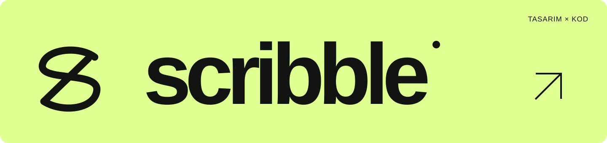
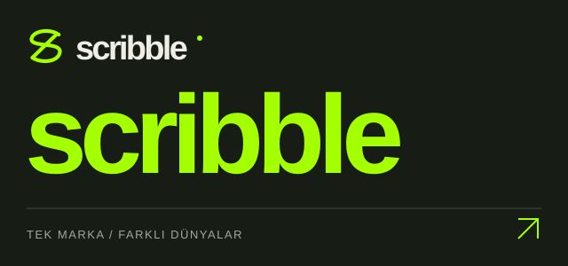

<a href="https://github.com/scribble-worlds">Scribble’ı keşfet ↗</a> &nbsp; / &nbsp; <a href="https://mkochandev.github.io/">Portföy ↗</a>

### Scribble nedir?

**Tek marka. Farklı dünyalar.**

Scribble, aynı markayı farklı sektörlerde yeniden hayal ettiğim tasarım ve geliştirme projesi. Her repoda Scribble, o sektörün gerçek bir markasıymış gibi ele alınıyor. Logo aynı kalıyor; görsel dil, içerik ve deneyim o dünyaya göre değişiyor.

Bugün bir streetwear markası, sıradaki projede bambaşka bir iş. Her yeni repo, Scribble’ın başka bir ihtimalini keşfediyor.

### Scribble’ı keşfet

<table><tr>
<td width="44%" valign="middle"></td>
<td width="56%" valign="middle">
SCRIBBLE / TASARIM SERİSİ

<strong>Tek marka. Farklı dünyalar.</strong>

Her repoda başka bir sektör. Aynı marka ve logo etrafında şekillenen web tasarımları ve dijital deneyimler.

<a href="https://github.com/scribble-worlds"><strong>Scribble’ı keşfet ↗</strong></a> &nbsp; / &nbsp; <a href="https://github.com/orgs/scribble-worlds/repositories">Tüm dünyalar ↗</a>

</td></tr></table>

### Diğer projelerim

<table>
<tr>
<td width="50%" valign="top">
 <strong>Erişte</strong> Aboneliklerin ve düzenli giderlerin tek yerde.  <a href="https://eriste.app/">Siteyi aç ↗</a> &nbsp; · &nbsp; <a href="https://github.com/Mkochandev/eriste-web">Kaynak kodu ↗</a>
</td>
<td width="50%" valign="top">
 <strong>GaziUstam</strong> Web, mobil uygulama ve yazılım danışmanlığı.  <a href="https://gaziustam.com/">Siteyi aç ↗</a> &nbsp; · &nbsp; <a href="https://github.com/Mkochandev/Gaziustam-Yazilim">Kaynak kodu ↗</a>
</td>
</tr>
</table>

 

---

<strong>muham²ed</strong> &nbsp; / &nbsp; tasarım × kod &nbsp; / &nbsp; <a href="https://github.com/Mkochandev">GitHub ↗</a>
