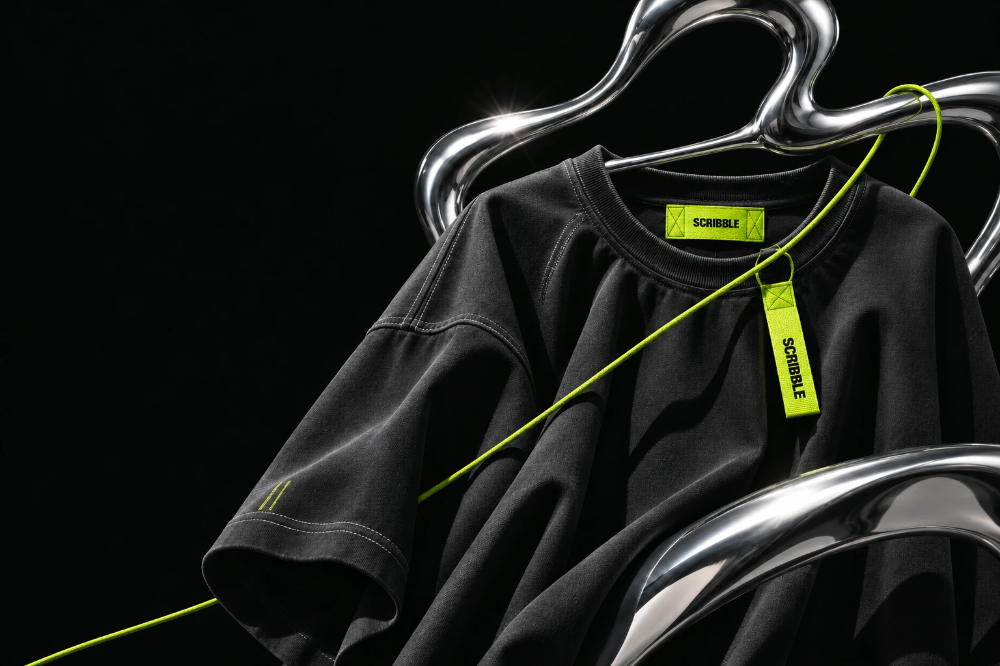

<a href="https://github.com/scribble-worlds">Scribble’ı keşfet ↗</a> &nbsp; / &nbsp; <a href="https://mkochandev.github.io/">Portföy ↗</a>

**Tek marka. Farklı dünyalar.**

Scribble, tek bir markayı farklı sektörlerde yeniden hayal eden bir tasarım serisi. İsim ve logo aynı kalır; her projede yeni bir dünya kurulur.

### Scribble dünyaları

<table><tr>
<td width="48%" valign="middle"></td>
<td width="52%" valign="middle">
<h2>001</h2>

Streetwear giyim markası konseptinde bir web tasarımı.

<a href="https://scribble-worlds.github.io/scribble-streetwear/"><strong>Projeyi keşfet ↗</strong></a> &nbsp; / &nbsp; <a href="https://github.com/scribble-worlds/scribble-streetwear">Kaynak kodu ↗</a>

</td></tr></table>

### Diğer projelerim

<table>
<tr>
<td width="50%" valign="top">
 <strong>Erişte</strong> Aboneliklerin ve düzenli giderlerin tek yerde.  <a href="https://eriste.app/">Siteyi aç ↗</a> &nbsp; · &nbsp; <a href="https://github.com/Mkochandev/eriste-web">Kaynak kodu ↗</a>
</td>
<td width="50%" valign="top">
 <strong>GaziUstam</strong> Web, mobil uygulama ve yazılım danışmanlığı.  <a href="https://gaziustam.com/">Siteyi aç ↗</a> &nbsp; · &nbsp; <a href="https://github.com/Mkochandev/Gaziustam-Yazilim">Kaynak kodu ↗</a>
</td>
</tr>
</table>

 

---

<strong>muham²ed</strong> &nbsp; / &nbsp; tasarım × kod &nbsp; / &nbsp; <a href="https://github.com/Mkochandev">GitHub ↗</a>
