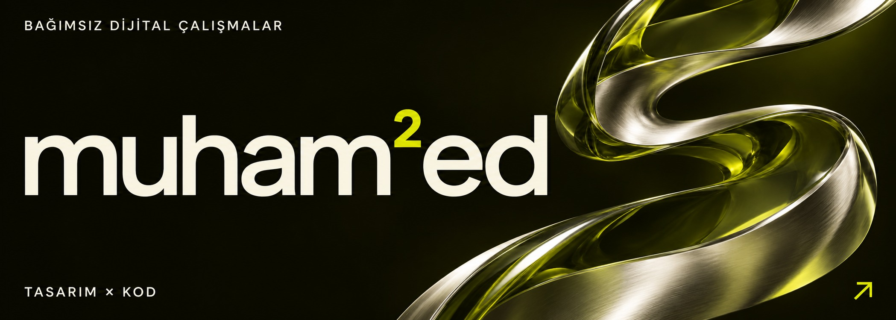

<a href="https://mkochandev.github.io/">Portföy ↗</a> &nbsp; / &nbsp; <a href="mailto:muhammedkochandev@gmail.com">Konuşalım ↗</a>

### Seçili işler

<table>
<tr>
<td width="50%" valign="top"></td>
<td width="50%" valign="top"></td>
</tr>
<tr>
<td><strong>Erişte</strong>  <a href="https://eriste.app/">Siteyi aç ↗</a> &nbsp; · &nbsp; <a href="https://github.com/Mkochandev/eriste-web">Kaynak kodu ↗</a></td>
<td><strong>GaziUstam</strong>  <a href="https://gaziustam.com/">Siteyi aç ↗</a> &nbsp; · &nbsp; <a href="https://github.com/Mkochandev/Gaziustam-Yazilim">Kaynak kodu ↗</a></td>
</tr>
</table>

 

<a href="https://github.com/search?q=user%3AMkochandev+scribble&amp;type=repositories">GitHub’da Scribble ara ↗</a> &nbsp; / &nbsp; <a href="https://mkochandev.github.io/#scribble">Seriyi incele ↗</a>

001 / Scribble — Streetwear · Hazırlık aşamasında.

  

---

<strong>muham²ed</strong> &nbsp; / &nbsp; tasarım × kod &nbsp; / &nbsp; <a href="mailto:muhammedkochandev@gmail.com">iletişim ↗</a>
