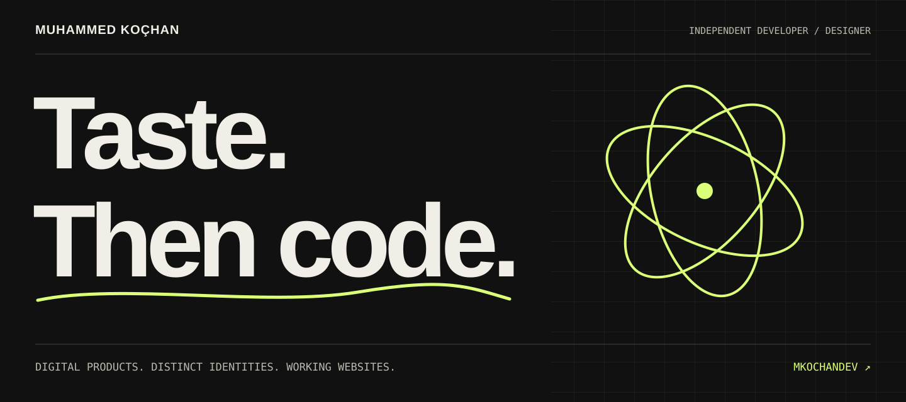
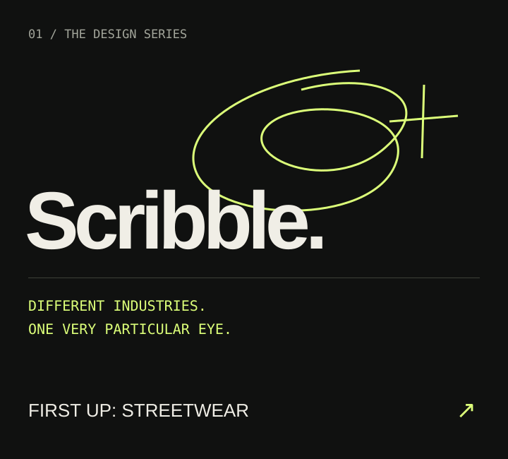
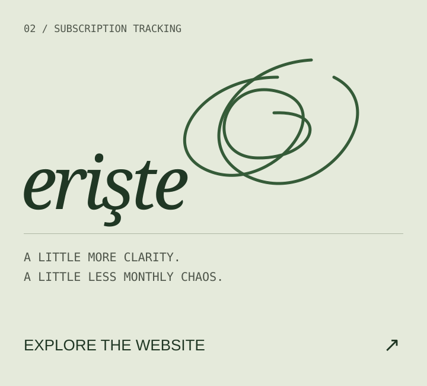
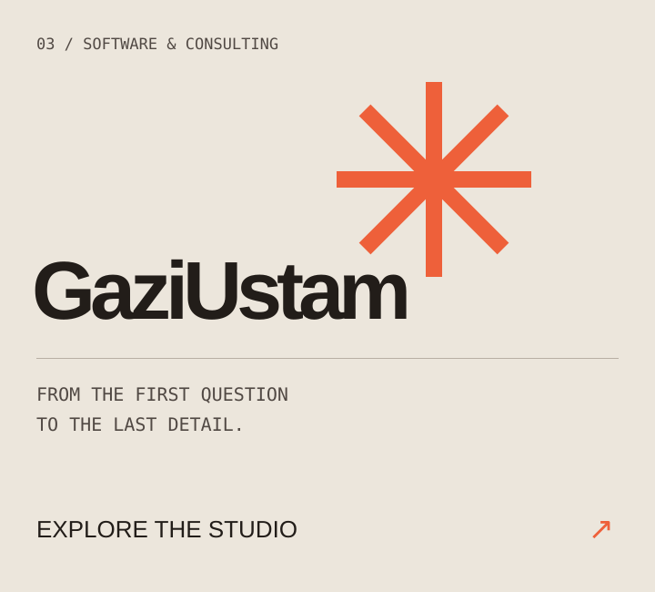

 

I build web and mobile products, and give them a visual identity worth opening twice. 
From the database to the last pixel. Based in Türkiye, building for the web.

<a href="https://mkochandev.github.io/">Portfolio ↗</a> &nbsp; / &nbsp;
<a href="https://gaziustam.com/">GaziUstam ↗</a> &nbsp; / &nbsp;
<a href="mailto:muhammedkochandev@gmail.com">Start a conversation ↗</a>

 

### Selected work / ongoing explorations

<table>
<tr>
<td width="33%" valign="top"></td>
<td width="33%" valign="top"></td>
<td width="33%" valign="top"></td>
</tr>
<tr>
<td valign="top"><strong>Scribble</strong> Independent website concepts. Edition 001: Streetwear — in preparation.</td>
<td valign="top"><strong>Erişte</strong> A clearer view of recurring subscriptions. <a href="https://github.com/Mkochandev/eriste-web">Website source ↗</a></td>
<td valign="top"><strong>GaziUstam</strong> Web, mobile and software consulting. <a href="https://github.com/Mkochandev/Gaziustam-Yazilim">Website source ↗</a></td>
</tr>
</table>

 

### Scribble / a series of digital first impressions

One industry. One distinct direction. One public repository.

**Scribble** is my ongoing series of sector-specific website concepts: built to browse, shared as portfolio work, and made in Turkish and English. Each edition gets its own visual world.

**001 — Scribble · Streetwear**  
A boutique clothing website concept. Project setup is in preparation; the storefront design comes next.

Repository naming: `scribble-[industry]` · Presentation: `Scribble — [Industry]` · All Scribble editions are concept demos.

 

### Under the surface

**Web & interfaces** &nbsp; HTML / CSS / JavaScript / TypeScript / Tailwind / Astro  
**Applications & APIs** &nbsp; Laravel / PHP / Node.js / Express / React Native / Expo  
**Data** &nbsp; MySQL / PostgreSQL / Supabase

 

---

MUHAMMED KOÇHAN &nbsp; / &nbsp; INDEPENDENT DEVELOPER & DESIGNER &nbsp; / &nbsp; <a href="mailto:muhammedkochandev@gmail.com">LET’S MAKE SOMETHING WITH CHARACTER ↗</a>
